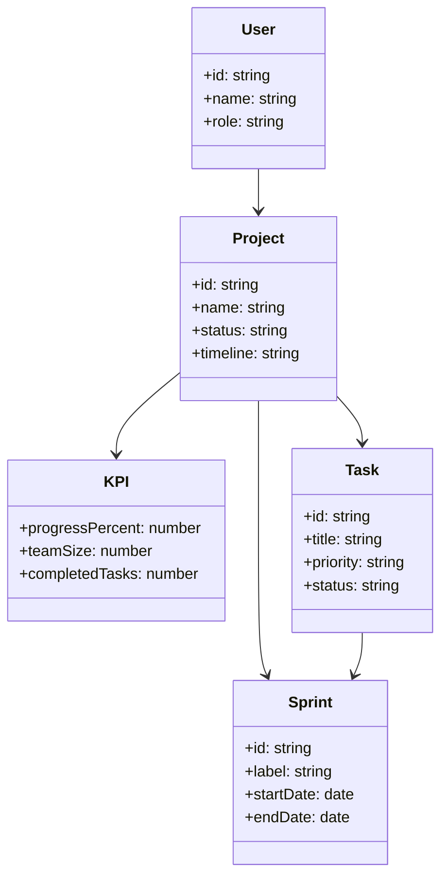

# Diagramme UML - Diagramme de classes

## Description

Le modèle met en évidence les relations entre les utilisateurs, les projets, les tâches et les sprints. Il permet de structurer le suivi d'avancement et le pilotage du projet sur plusieurs itérations.
