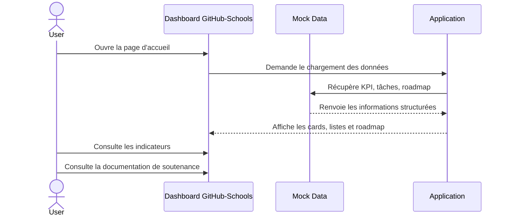

# Diagramme UML - Diagramme de séquence

## Description

Ce diagramme représente le flux de chargement des données depuis le modèle de données vers le tableau de bord. Il montre la logique simple et claire d'un système de démonstration avec un design professionnel.
