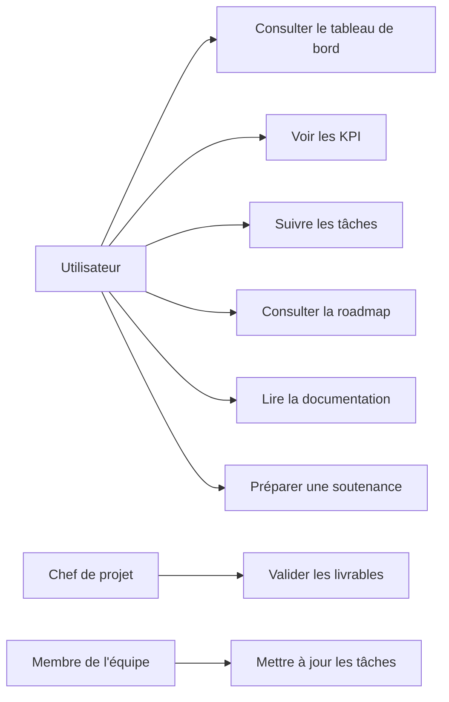

# Diagramme UML - Cas d'utilisation

## Description

Le système permet à un utilisateur de visualiser le statut global du projet, de consulter les tâches, la roadmap et la documentation associée. Les rôles administrateur et membre de l'équipe complètent la logique de contribution et de validation.
